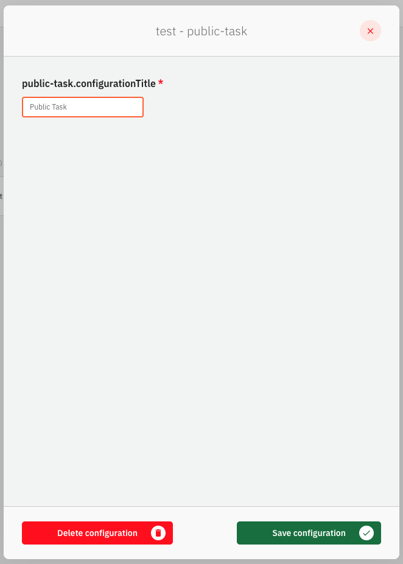
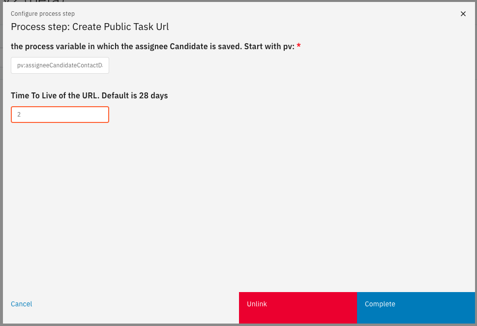
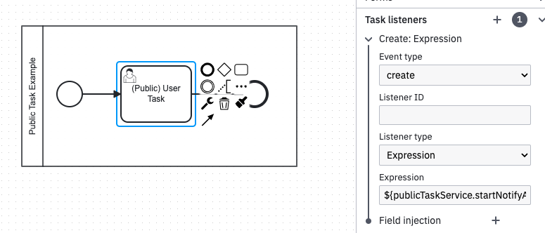
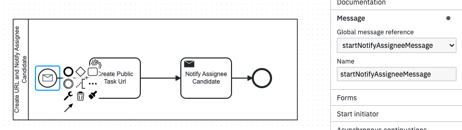

# Public Task Plugin

The Public Task Plugin exposes a User Task outside of the Valtimo user environment. It generates an HTML, an assignee candidate receives a URL and is able to submit the task within the HTML. 
From there Valtimo will pick up the submission and complete the task.

The Public Task Plugin is not a standard part of Valtimo. It is available in the Plugins Repo. More information can be found [here](/introduction/modules/plugin-introduction.md#plugins-repo).

## Configure the plugin

A plugin configuration is required before the plugin can be used. A general description on how to configure
plugins can be found [here](../configure-plugin.md).

Besides the plugin title there is one optional field:

- **URL of this environment**: what every link this configuration produces starts with, for example
  `https://my-app.example.com`. Without a scheme it is read as an `https` address.

When left empty it falls back to `valtimo.url` (`VALTIMO_URL`), or to `valtimo.app.hostname`
(`VALTIMO_APP_HOSTNAME`, combined with `valtimo.app.scheme`). If none of these is set, creating a link fails
with a message saying so. The URL is stored with each public task, so links that were already sent out keep
pointing at the address they were created with.

An example plugin configuration:

## Available actions

The Public Task plugin supports the following actions that can be configured in process links in order to store
documents and their metadata.

A general description on how to create process links, can be found [here](../../process-link/create-process-link.md).

### Create Public Task

The **Create Public Task** renders a URL with a public task id. This URL can be sent to the assignee candidate and fetches an automatically generated HTML, 
with the Form.io form of the User Task in question. This form can be completed the same as within Valtimo and sends the submission to the plugin, which uses the submission,
in combination with the public task id, to complete the User Task and store the data in the Document.

When creating a process link the following properties have to be entered:
- **AssigneeCandidateContactData**: It is up to the implementation by what means the URL is communicated. The contact data of the user needs to be a process variable. The variable name needs to be set here. Starting with pv:
- **TimeToLive**: This is the amount of days that the Public Task remains available after initialization.

The following properties are optional and only matter when the form contains an upload field. They are read
when the public task is created and stay with it.

| Property                          | Default          | Description                                                          |
|-----------------------------------|------------------|----------------------------------------------------------------------|
| **Maximum number of attachments** | 10               | How many files may be uploaded through one link.                     |
| **Maximum file size**             | 10485760 (10 MB) | How large one file may be, in bytes.                                 |
| **Accepted file types**           | empty            | Comma separated mime types. Empty leaves it to the upload field and to `valtimo.upload.accepted-mime-types`. |
| **Attachment metadata**           | empty            | Key/value pairs written on every uploaded file, see below.           |

Leaving a field empty means "use the default", never "no limit".

an example process link configuration: 

### Uploading documents

Upload fields (**Valtimo File Upload**, **Documenten API** upload fields and plain Form.io file components) work
in the public form. Files are stored in Valtimo's temporary resource storage and handed to the process through
the submission, exactly like an upload from a task inside Valtimo. Whatever already handles those, for example a
**Store uploaded document** service task of the Documenten API plugin, keeps working.

- An upload field can be stricter than the process link with its own **Maximum File Size** and **File Pattern**
  settings, never more permissive.
- The type of a file is detected from its content, not from its name.
- A submission can only refer to files that were uploaded through the same link for the same case, or to files
  of the case that the form showed prefilled.
- The Documenten API needs at least `informatieobjecttype` and `titel` in the **Attachment metadata**. Values can
  be fixed text or a reference such as `pv:informatieobjecttypeUrl` or `doc:/aanvraag/onderwerp`, resolved when
  the public task is created. The keys `filename`, `contentType`, `user`, `documentId`, `filePath` and
  `fileSize` are set by the plugin and cannot be configured.

Worth knowing when deploying:

- Temporary resources are removed after `valtimo.temporaryResourceStorage.retentionInMinutes` (default 60). A
  public form is often open longer than that, so consider raising it.
- `spring.servlet.multipart.max-file-size` (and `max-request-size`) cap every upload before the plugin sees it.
- `valtimo.upload.accepted-mime-types` is the application-wide limit on file types. The upload endpoint does not
  require authentication, so set it, or set **Accepted file types** on the process link.

### Implementing the plugin
The plugin is designed to be able to be added to an existing user task. Because Valtimo can only link 1 action to a task, and this needs to be the form, the following can be done:

1. Add a **Task listener** with a **Create: Expression**. In the expression, add the following function call: **${publicTaskService.startNotifyAssigneeCandidateProcess(task)}**. 
   
An example of the process: 

 
2. This will correlate a message to start a new subprocess. Add this subprocess to the implementation.
   
An example of the process: 

3. Link the Process Link to the **Create Public Task URL task**
4. Implement a notification function to send the URL to the Assignee candidate
5. Part of the plugin code is a controller with three endpoints, none of which require authentication. `GET /api/v1/public-task/{publicTaskId}` is called by the created URL and sends back an HTML page with the form that is linked to the user task. The form is only served while the public task is not completed and not expired.
6. `POST /api/v1/public-task/{publicTaskId}` is called by the form with the submission and completes the task with said submission.
7. `POST /api/v1/public-task/{publicTaskId}/attachment` receives a file chosen in an upload field of the form.

Links created by earlier versions, with the public task id as a `publicTaskId` query parameter, keep working.

Note: examples of the processes can be found in the repo of the plugin. This is only an option for implementation.

### Audit

When a public task is completed, this will be logged as a **Public Task**
